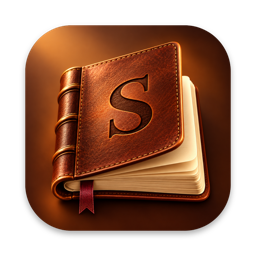
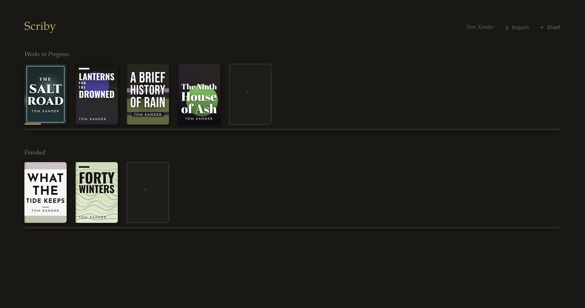
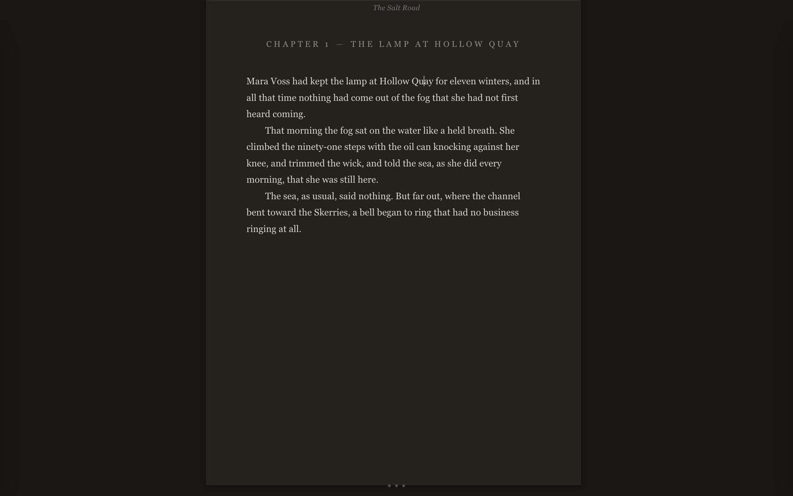
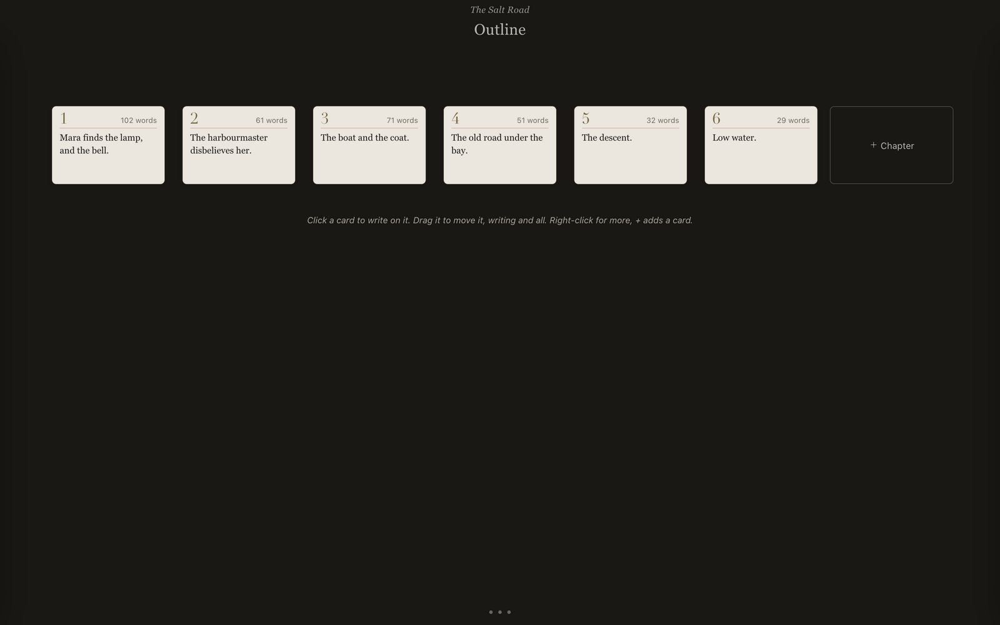
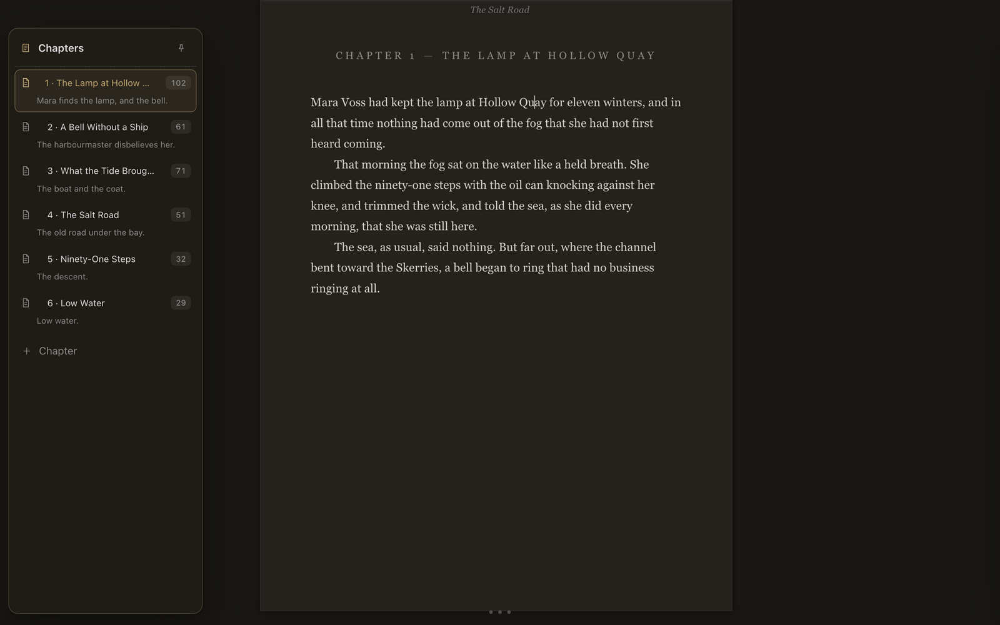
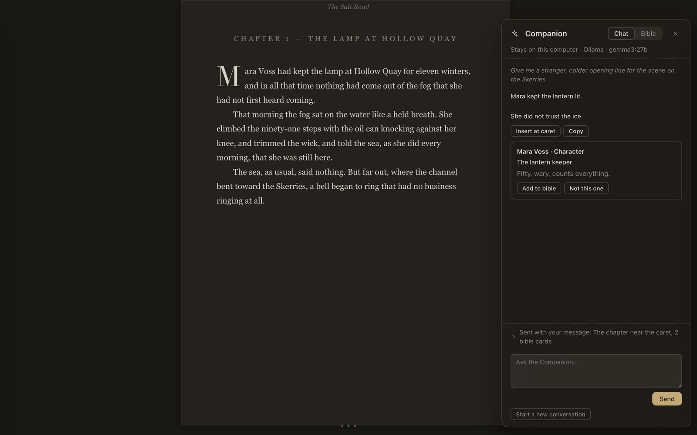
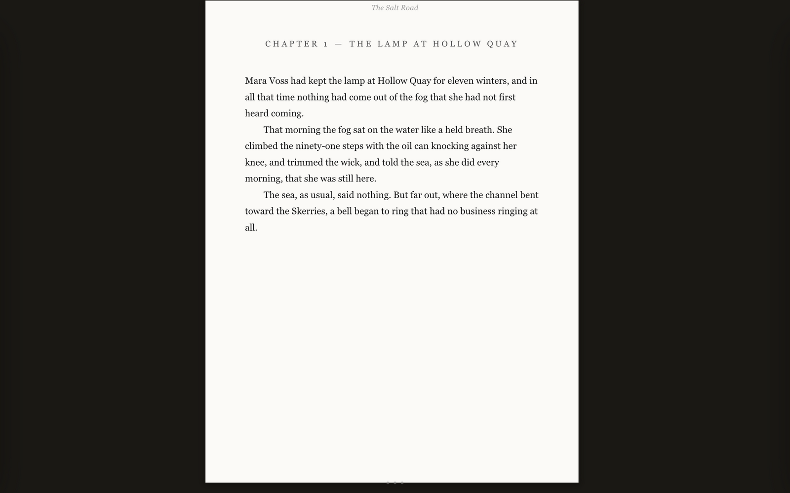
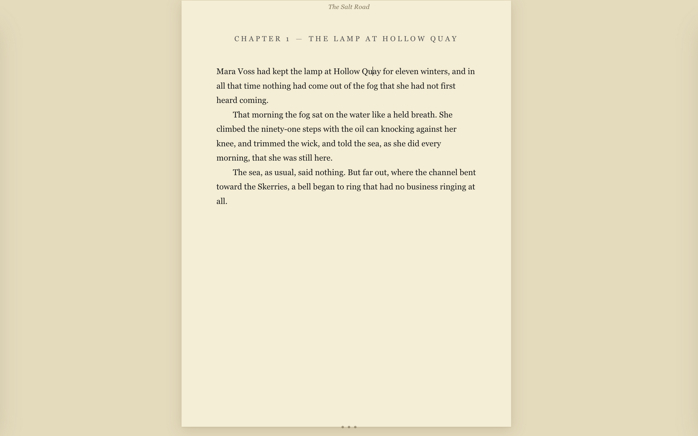
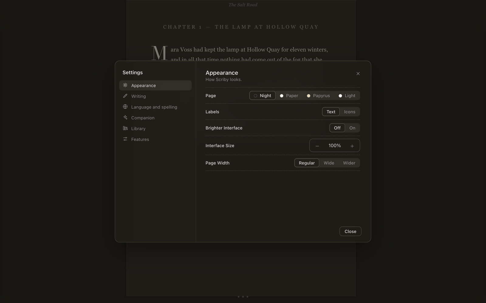

<div align="center">



# Scriby

### A quiet place to write your book.

A distraction-free word processor for authors, for Mac.<br>
Your library is a bookshelf, the page is calm, and your words stay in plain files on your disk.

<br>

[](https://github.com/tomxander/Scriby/releases/latest)
&nbsp;

&nbsp;
[](LICENSE)

<br>

[**⬇ Download**](#install) &nbsp;·&nbsp; [**Screenshots**](#screenshots) &nbsp;·&nbsp; [**Features**](#features) &nbsp;·&nbsp; [**Companion**](#the-companion) &nbsp;·&nbsp; [**FAQ**](#faq)

<br>



</div>

<br>

## Why Scriby

<table>
<tr>
<td width="33%" valign="top">

### 🕯 A quiet page
Dark by default, with book typography, drop caps and controls that fade until you reach for them. Nothing pops up while you type.

</td>
<td width="33%" valign="top">

### 📚 Made for books
Shelves, chapters, outline cards, a Darlings drawer for cut passages, KDP paperbacks, EPUB, Word and manuscript-format exports.

</td>
<td width="33%" valign="top">

### 🗂 Yours, in plain files
No accounts, no subscription, no lock-in. Every book is a folder of readable files that you can sync, back up and open anywhere.

</td>
</tr>
</table>

## Screenshots

<table>
<tr>
<td width="50%"><br><sub><b>The page.</b> Book typography, drop caps, controls that stay out of the way.</sub></td>
<td width="50%"><br><sub><b>Outline cards.</b> Every chapter is a card; drag one and the writing moves with it.</sub></td>
</tr>
<tr>
<td width="50%"><br><sub><b>Chapters.</b> A floating panel with notes and word counts, there when you hover the edge.</sub></td>
<td width="50%"><br><sub><b>The Companion.</b> Ask a model for help and keep a story bible. It speaks only when you press Send.</sub></td>
</tr>
<tr>
<td width="50%"><br><sub><b>Paper.</b> Night, Paper, Papyrus and Light are one click apart in Settings.</sub></td>
<td width="50%"><br><sub><b>Papyrus.</b> Warm and easy on the eyes for long days.</sub></td>
</tr>
</table>

<sub>Screenshots show a demo library with invented text. The Companion reply is a demo answer.</sub>

<details>
<summary><b>⚙️ Settings</b></summary>

<br>



Everything you set once lives in **File → Settings…**: the page, labels, interface size, writing options, languages, the Companion's connection, and your library.

</details>

## Install

**Requirements:** a Mac running a recent version of macOS, Apple silicon or Intel.

1. Download the right DMG from the **[latest release](https://github.com/tomxander/Scriby/releases/latest)**:
   - **`Scriby-1.6.0-stable-arm64.dmg`** for Apple silicon Macs (M1 and later)
   - **`Scriby-1.6.0-stable-x64.dmg`** for Intel Macs

   Not sure which you have? Choose  → **About This Mac**: "Chip: Apple M…" means Apple silicon, "Processor: Intel…" means Intel.
2. Open it and drag **Scriby** onto the **Applications** folder in the window, then eject the disk image.
3. Open Scriby. The first time, macOS says it could not verify the app, because it is not yet notarized by Apple. Click **Done** (not Move to Bin), then open **System Settings → Privacy & Security**, scroll to **Security**, click **Open Anyway** next to "Scriby was blocked", and confirm. You only do this once.

   Prefer Terminal? `xattr -dr com.apple.quarantine /Applications/Scriby.app`, then open Scriby.

**Updating:** download the newer DMG from Releases and drag Scriby over the old copy. Your library is untouched.

## Quick start

| Do this | To get this |
|---|---|
| Press **Enter** | A new paragraph |
| Press **Enter** twice | A section break (`***`) |
| Press **Enter** three times | A new chapter |
| Drag a passage onto the **Darlings** tab | It leaves the page but is never lost |
| **⌘⇧X** | A placeholder mark and a sticky note, for later |
| **⌘S** | A snapshot of the whole book |
| **⌘E** | Email yourself a copy of the work in progress |
| **⌘,** | Settings |
| **⌘/** | The full shortcut list |

The goal is to keep writing. Chapters number and renumber themselves, quotes and dashes sort themselves out, and spellcheck runs only when you ask for it.

## Features

<table>
<tr>
<td width="33%" valign="top">

**📚 Bookshelf**<br>
Labeled shelves, cover art, progress bars toward your word goals, drag and drop everywhere.

</td>
<td width="33%" valign="top">

**🗂 Outline cards**<br>
Plan with index cards that are the manuscript. Move a card, move the writing.

</td>
<td width="33%" valign="top">

**🧟 Darlings**<br>
Cut freely. Passages wait in a drawer and restore to the exact spot.

</td>
</tr>
<tr>
<td valign="top">

**✨ The Companion**<br>
A drafting and world-building assistant with a story bible, hosted or fully local.

</td>
<td valign="top">

**🎬 Screenplays**<br>
Industry-format scripts, Fountain and Final Draft import and export.

</td>
<td valign="top">

**📖 Bound books**<br>
Bind a shelf into an omnibus, trilogy or collection with front and back matter.

</td>
</tr>
<tr>
<td valign="top">

**📤 Export**<br>
EPUB 3, Word, PDF, KDP paperback interiors, standard manuscript format.

</td>
<td valign="top">

**🛟 Safe by design**<br>
Continuous autosave, snapshots, daily backups and plain files.

</td>
<td valign="top">

**🌍 15 languages**<br>
The interface speaks English, French, Spanish, German and more.

</td>
</tr>
</table>

<br>

### Features in depth

*Click a feature to open it.*

<details>
<summary><b>📚 The bookshelf</b></summary>

Your library looks like a bookshelf, not a file list. Labeled shelves you organize however you like — by series, by status, by pen name. Progress bars on the covers show how far you are from your word goals. You can drag-and-drop books anywhere. You can also drag shelves around and put cover art on your titles.

</details>

<details>
<summary><b>📄 Just a blank page</b></summary>

Scriby opens in a dark room (Night) by default. Prefer paper? **File → Settings… → Appearance** switches to Paper, Papyrus or Light, and your choice is remembered on that Mac. Controls fade until you mouse over them. Chapters number and renumber themselves automatically. Drop caps mark chapter openings, because a book should look like a book. Em dashes, true ellipses, and curly quotes sort themselves out as you type. Spellcheck exists only when you invoke it — no more red squiggles mid-sentence triggering your imposter syndrome.

</details>

<details>
<summary><b>⏎ Enter, Enter, Enter</b></summary>

One Enter: new paragraph. Two: a `***` section break. Three: a new chapter. The goal is to KEEP WRITING.

Right-click the first chapter's heading to make it a prologue, or the last one's to make it an epilogue: they step out of the numbering, and everything renumbers.

</details>

<details>
<summary><b>🧟 Darlings</b></summary>

The writing advice is "kill your darlings" — but here we *keep the bodies*. Drag any beautiful-but-in-the-way passage onto the Darlings tab. It leaves your manuscript but isn't lost. Darlings restore to the exact spot it came from. More like zombies than darlings.

</details>

<details>
<summary><b>📌 Placeholders</b></summary>

Mid-flow and need a name, a fact, a date? ⌘⇧X drops a mark and a sticky note. The left panel shows a red dot on every chapter that you need to get back to. The right panel will list all these to-do items.

</details>

<details>
<summary><b>🗂️ Outlining with index cards</b></summary>

The Outline tab lays your book out as index cards, set like a page: they read left to right, line after line, so forty short chapters or a story of thirty scenes both fill the window. Each chapter starts at its big numeral, with its sections following on the same mat. Click a card and write a few lines on it. A section's note shows up in the manuscript as a gray ghost paragraph, and once you start writing, it rides one line below your words until you dismiss it. Drag a card to move it and the writing moves with it (⌘Z puts it back). Pantsers get cards too: every chapter and every *** section is already a card, showing its first line until you give it a note. Ideas without a home wait on loose cards in the right-hand panel. ⌘− shrinks the cards until a whole novel fits on one screen, and the old list is one click away. Pantsers can ignore all of it or learn to draw a freakin' map for the first time. Try it. You might like it!

</details>

<details>
<summary><b>🎨 Cover Art</b></summary>

Every book gets a cover! New books are dressed in a seeded abstract (six art styles, six type templates, typefaces bundled with Scriby) so no two stories on the shelf look alike. Once a story passes 1,000 words, Scriby can read it and paint an abstract cover from the text. This is a bit more work but totally worth it. Get an OpenAI API key from their website and paste it into **File → Cover Art…**. The art is generated in the background for about a penny a picture. (These are not meant for publication, just writing inspiration!) The API key is stored encrypted in Scriby's own settings, never in your library folder. The title and author are always set in real type on top, so the lettering is never left to a gen-AI model. The ↻ on any book re-rolls its type and colors, or paints it again. And you can always switch back and forth from the seeded modern look to the painted variety.

</details>

<details>
<summary><b>✨ The Companion</b></summary>

Ask the Companion (⌘⇧K, behind *Show More Features*) to help you draft, think through a scene, or build characters and the world: a story bible of cards that lives in your book folder. It connects to a hosted model (Claude, OpenAI, any OpenAI-compatible service) or to a model on your own Mac (Ollama, LM Studio), set up in **File → Settings… → Companion**. It speaks only when you press Send, shows exactly what is sent, and nothing reaches your manuscript unless you choose Insert or Replace. Keys are kept in the system keychain, never in your library.

</details>

<details>
<summary><b>🎯 Goals and momentum</b></summary>

Daily word goals, word sprints, and a NaNoWriMo-style progress chart. Needs more testing.

</details>

<details>
<summary><b>📖 A shelf can become one book</b></summary>

Right-click a shelf's name and choose **Bind into one book** for an omnibus, a trilogy, or a story collection. Hover over the bound shelf and the pages a published book carries show up faintly in their places: copyright, dedication, epigraph, prologue, epilogue, acknowledgments, about the author. A small + before each title starts a Part. Click a page and type it the way it will print; a prologue or epilogue opens in the editor like any story. The export is one EPUB, Word file, or PDF with a single cover and one table of contents, and chapters can number straight through the whole book. Unbind any time. Nothing is lost.

</details>

<details>
<summary><b>🎬 Screenplays</b></summary>

Right-click the + on any shelf and choose **New Script**. Scripts sit on the same shelves as your books, on white card stock with two brass brads. Inside, the page is set the way it will print: Courier Prime, pages, page numbers, a proper title page.

You never have to pick a formatting element. Start a line with INT. or EXT. and it's a scene heading. Type a name in capitals, hit Enter, and the next line is dialogue. Hit Enter twice after a speech and you're on the next speaker, with whoever is being answered already there in gray. Tab or Enter fills it in. ⌘1 through ⌘7 will let you pick an element yourself, the same keys Final Draft uses. The left panel lists your scenes and how long each one runs, in eighths of a page. Drag a scene to move it. (CONT'D) happens automatically. The Outline tab lays every scene out as an index card: its heading, its length, who's in it, and a note you can write on it. Drag the cards to restructure the script, or start a script as a stack of cards and write it from there.

Export an industry-format PDF, or a Fountain or Final Draft (.fdx) file. Drop a .fountain or .fdx file on a shelf to import a script. Notes, Darlings, placeholders, sprints, and the rest all work the same as they do for books.

</details>

<details>
<summary><b>📤 Exports</b></summary>

EPUB 3 with a proper table of contents built to KDP's guidelines, Word .docx, PDF with page numbers and bookmarks, HTML, markdown, and plain text. Email a timestamped PDF snapshot to yourself with a SHA-256 fingerprint of the text in the body. Might come in handy someday.

</details>

<details>
<summary><b>📥 Import</b></summary>

Bring in existing .docx, .txt, and .md manuscripts; chapters and scene breaks are detected automatically. This is still a bit rough and might require you to tweak things. It will try to grab your title and remove that from the body, and it seems to be working okay.

</details>

<details>
<summary><b>🛟 Backups</b></summary>

Continuous autosave, daily zip backups kept for two weeks, everything stored as plain files. Set up your Scriby library folder on your iCloud if you want for extra safety. You can also email copies of your WIP to yourself with a keystroke: ⌘E.

</details>

## The Companion

A drafting partner that stays out of the way. Open it with **⌘⇧K** (turn on *Show More Features* first) and ask it to help with a scene, a line of dialogue, a character, or the rules of your world.

- **You choose where it runs.** Claude, OpenAI or any OpenAI-compatible service, or a model on your own Mac through Ollama or LM Studio.
- **It speaks only when you press Send.** Nothing suggests, underlines or runs while you type.
- **You see what is sent.** The pane lists the selection, nearby text, outline and bible cards that go with your message, and nothing else.
- **Your manuscript is protected.** Words reach the page only through *Insert* or *Replace*, which go through undo, and a replaced passage goes to Darlings first.
- **A story bible.** Characters, places, factions, rules and objects live as cards in your book folder. The Companion proposes cards; nothing is added unless you accept it.
- **Keys stay private.** They are kept in the system keychain, never in your library.

Set it up in **File → Settings… → Companion**, which has a Test button.

## Your files and privacy

Everything lives in `~/Documents/NEO Library`, one folder per book, with chapters as readable HTML and metadata as JSON. Open them in any text editor.

```
NEO Library/
  library.json            shelves and settings
  Backups/                a zip per day, two weeks kept
  book-<title>-<id>/
    book.json             title, chapter order, notes
    chapters/<id>.html    your text
    darlings.json         passages you set aside
    bible.json            the Companion's story bible
```

(The folder keeps its original name so that existing libraries keep working. **File → Library Folder…** moves it anywhere, including iCloud Drive.)

Scriby has no analytics and no account. Your writing leaves your Mac only if you send it: to a Companion model you chose, to OpenAI when you turn on painted covers, or when you email yourself a copy.

## Languages

English, French (including Canadian), Spanish, Portuguese (Brazil and Portugal), German, Italian, Dutch, Polish, Romanian, Russian, Greek, Hungarian, Korean and Turkish. Pick one under **View → Language**; Scriby follows your system language the first time. Newer strings fall back to English until they are translated. See [TRANSLATING.md](TRANSLATING.md) to add a language.

## FAQ

<details>
<summary><b>Does it need an internet connection?</b></summary>

No. Scriby works fully offline. Only the Companion (with a hosted model), painted covers and update downloads use the network, and only when you ask.

</details>

<details>
<summary><b>Why does macOS warn me when I open it?</b></summary>

The app is not yet notarized by Apple, which needs a paid developer account. Follow step 3 under [Install](#install); it is needed once.

</details>

<details>
<summary><b>Does it work on Intel Macs, Windows or Linux?</b></summary>

It runs on both Apple silicon and Intel Macs; each has its own DMG on the release page. Windows and Linux are not part of this repository.

</details>

<details>
<summary><b>Can I use my existing NEO library?</b></summary>

Yes. Scriby reads the same `NEO Library` folder and the same plain files.

</details>

<details>
<summary><b>Is my writing safe?</b></summary>

Scriby autosaves as you type, takes a snapshot before each writing day, keeps a daily backup zip for two weeks, and never throws words away: deleted passages go to Darlings or the system Trash.

</details>

<details>
<summary><b>How do I update?</b></summary>

Check **Releases** for a newer version, download its DMG, and drag Scriby over the old copy.

</details>

## Roadmap

- [ ] Notarized builds, so the first-launch warning goes away
- [ ] Mac App Store release (see [MAC_APP_STORE.md](MAC_APP_STORE.md))
- [ ] A consistency check between the story bible and the chapters
- [ ] Global end matter that updates every book at once (copyright pages, bios and so on)

## Documentation

| | |
|---|---|
| [TUTORIAL.md](TUTORIAL.md) | A short walkthrough of writing in Scriby |
| [TRANSLATING.md](TRANSLATING.md) | Adding or improving a language |
| [MAC_APP_STORE.md](MAC_APP_STORE.md) | The plan for the Mac App Store |
| [CONTRIBUTING.md](CONTRIBUTING.md) | Ideas, bug reports and contributions |
| [AGENTS.md](AGENTS.md) | How the code is organised |
| [NOTICE.md](NOTICE.md) | Attribution and third-party credits |

## Contributing

Scriby is opinionated by design: a change belongs here if it helps someone finish a book. Bug reports and ideas are welcome as [issues](https://github.com/tomxander/Scriby/issues); see [CONTRIBUTING.md](CONTRIBUTING.md). Because of Scriby's license, code contributions are accepted only with Thomas Alex's agreement.

## License and credits

Scriby is © 2026 Thomas Alex, under the [Scriby License](LICENSE): anyone may use it, but not copy, modify, redistribute or sell it without permission.

It is based on **NEO** by **[Hugh Howey](https://hughhowey.com)**, whose original work is MIT-licensed; his copyright and license are kept in [LICENSE-NEO-MIT](LICENSE-NEO-MIT). Fonts, dictionaries and other bundled components keep their own licenses; see [NOTICE.md](NOTICE.md).

<div align="center">
<br>
<sub>Made for people who finish books.</sub>
</div>
